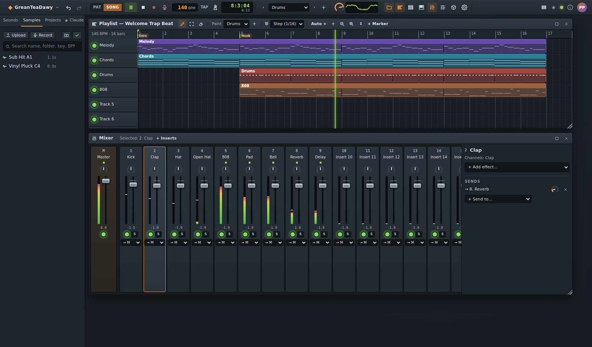
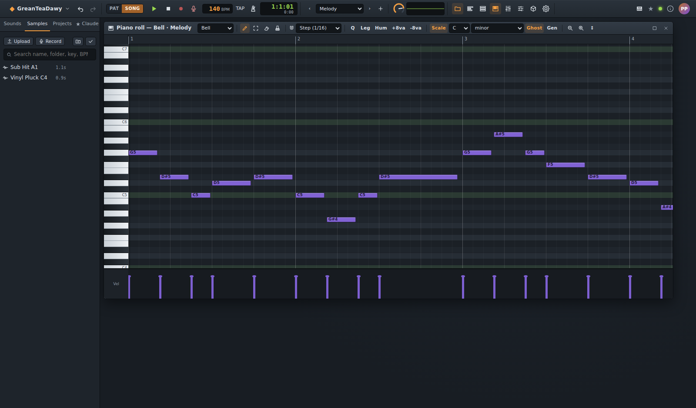
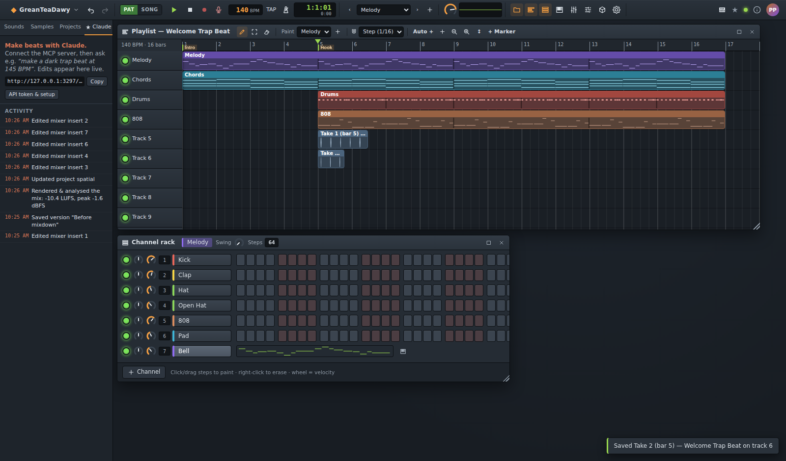
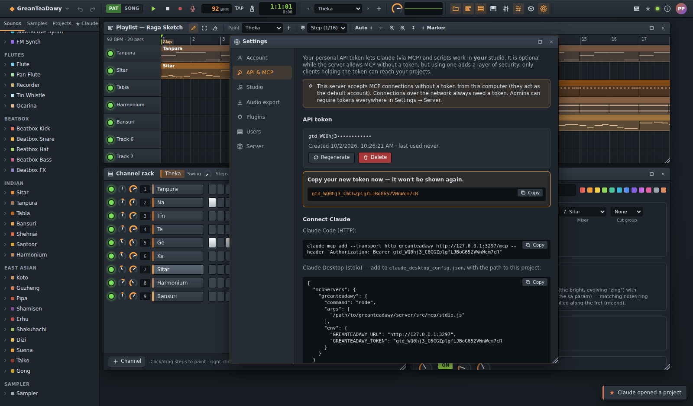
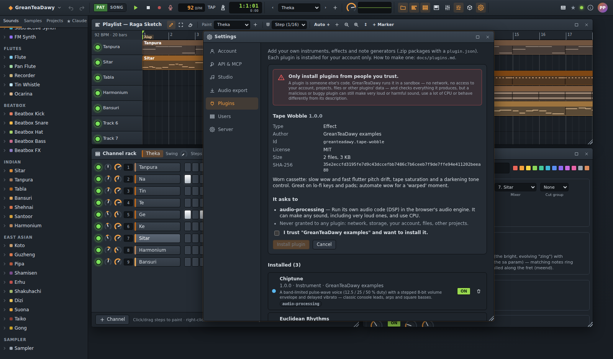
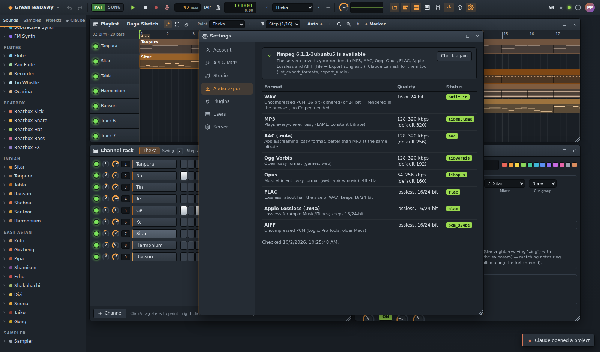
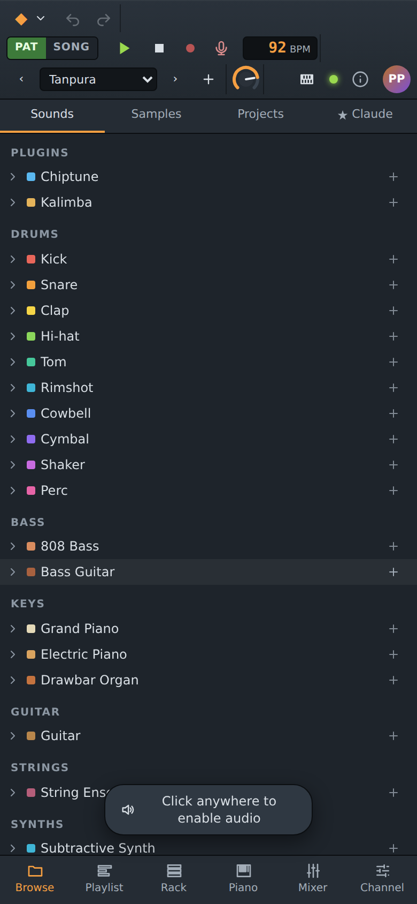
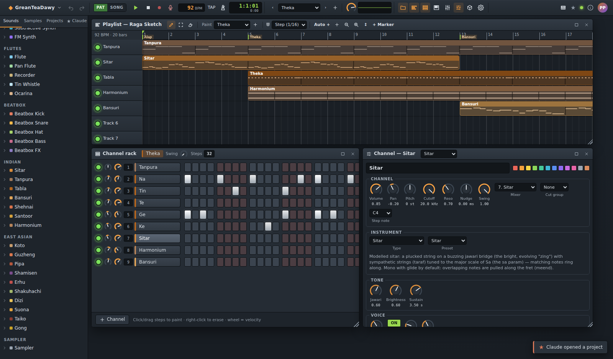
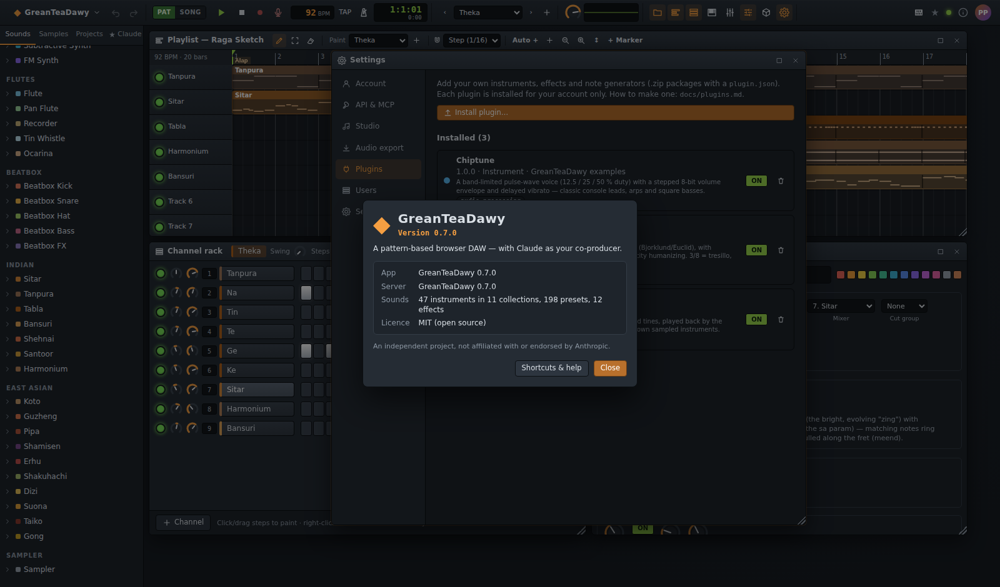

# ◆ GreanTeaDawy

**A pattern-based browser DAW — with Claude as your co-producer.**

GreanTeaDawy is an open-source, self-hosted beat-making studio: channel rack and step sequencer, piano roll, playlist,
mixer with effects, automation, sampler and audio clips, all running in the browser with a Node.js backend. Its
built-in [MCP](https://modelcontextprotocol.io) server gives Claude 78 music-production tools, so you can say
*"make a dark trap beat at 145 BPM and mix it for streaming"* and watch every edit appear live in your studio.

[](LICENSE)


[](docs/screenshots/studio.png)

> GreanTeaDawy is an independent experimental project. It is not affiliated with or endorsed by a Music Software company.

## Contents

- [Features](#features) · [Screenshots](#screenshots) · [Quick start](#quick-start) · [Make music with Claude](#make-music-with-claude)
- [Configuration](#configuration) · [Docker](#docker) · [Documentation](#documentation) · [Development](#development)
- [Security](#security) · [Troubleshooting](#troubleshooting) · [Contributing](#contributing) · [Licence](#licence)

## Features

**Studio**

- **Channel rack & step sequencer** — per-channel volume/pan/mute/solo, swing, pattern length, fills, randomize,
  choke groups, per-channel groove (nudge in ms, swing share), mini piano-roll previews for melodic channels.
- **Expressive velocity** — a hardware-style squared curve, and softer notes are darker (drums, filters, FM, sampler,
  piano/guitar/bass tone).
- **Instruments** — synthesized kick, snare, clap, hats, toms, rim, cowbell, cymbal, shaker, perc; 808 bass with glide
  and distortion; 3-oscillator subtractive synth; FM synth; **sampler** for your own audio; and a GarageBand-style
  band: modelled **grand piano**, **electric piano** (tine/reed), **drawbar organ** (percussion, rotary), **guitar**
  (acoustic/nylon/electric), **bass guitar** (finger/pick/slap/upright) and **strings** (ensemble or solo; legato,
  staccato, pizzicato). Four world collections: **flutes** (concert, pan, recorder, tin whistle, ocarina),
  **beatbox** (mouth kick, snares, hats, bass, scratch/click-roll FX), **Indian** (sitar with jawari and sympathetic
  strings, tanpura, tabla bols, bansuri, shehnai, santoor, harmonium) and **East Asian** (koto, guzheng, pipa,
  shamisen, erhu, shakuhachi, dizi, suona, taiko, gong): 47 instruments, about 200 presets, plus Japanese
  pentatonic and Indian thaat scales.
- **Piano roll** — draw/select/erase tools, chord stamp, snap, quantize, legato, humanize, scale highlighting, ghost
  notes, velocity lane, copy/paste/duplicate, keyboard nudging.
- **Playlist** — pattern, audio and automation clips on up to 200 tracks; section markers; audio clip gain, fades and
  repitch-to-tempo; loop region; song/pattern mode.
- **Mixer** — inserts with faders, pan, routing and sends; EQ with high/low-pass, filter, compressor (with parallel
  mix), delay, reverb (room size, frequency-dependent decay), distortion, chorus, phaser, bitcrusher, stereo width with
  mono bass, **kick-triggered sidechain**, and a limiter with a −1 dB default ceiling and an oversampled clip stage.
  Automation for any automatable param.
- **Spatial (Dolby Atmos-style) mixing** — make inserts 3D objects in a room (x/y/height, LFE send), move them with
  automation, monitor **binaurally** on headphones, and export binaural, **5.1 / 7.1 / 7.1.4** WAVs, object stems with
  position data or an experimental **ADM BWF** ([docs/spatial.md](docs/spatial.md)).
- **Export formats** — WAV (16/24-bit), and with ffmpeg on the server MP3, AAC, Ogg Vorbis, Opus, FLAC, Apple
  Lossless, AIFF (Settings → Audio export shows what's available).
- **Plugins** — add your own **instruments** (DSP code or multisampled), **effects** and **note generators** as `.zip`
  packages. They run sandboxed in the browser (audio worklet / an isolated, network-less iframe), ask for explicit
  permissions and are only installed after you confirm you trust the author ([docs/plugins.md](docs/plugins.md),
  examples in [`plugins/`](plugins)).
- **Recording** — notes from the computer keyboard or a MIDI keyboard (Web MIDI), metronome, tap tempo; and **audio
  from a microphone**, alone or over the song/pattern with count-in, metronome and latency compensation: every take is
  saved as a sample and placed on the playlist where you recorded it.
- **Sample library** — upload or record WAV/MP3/OGG/FLAC/AIFF/M4A/WebM; **folders** (drag to file, bulk move/delete),
  **search** by name, folder, key or tempo; codec, sample rate, bit depth, bitrate, channels, tags plus an analysis
  (LUFS, peak, spectrum, tempo, key, pitch, one-shot vs loop). Deleting a sample in use says which projects it leaves
  silent.
- **Wave editor** — select (zero-crossing snap), cut/copy/paste, trim, fades, gain, normalise, reverse, invert, DC
  removal, speed, **time stretch**, **pitch shift**, undo/redo; save as a new sample or replace the original everywhere
  (with a warning that lists every project using it).
- **Pitch correction** — auto-tune a voice or solo instrument to the project's key and scale with amount, speed and
  flatten (natural to robotic), see the sung and corrected pitch, and drag single notes up or down by hand.
- **Projects** — genre templates (with shared FX buses and sidechain), versions (named snapshots), undo/redo,
  16-bit (dithered) or 24-bit WAV, **stems**, MIDI and project export, MIDI import.
- **Live sync** across tabs and devices, mobile-friendly layout, keyboard-accessible controls.

**Claude integration (MCP)**

- **Streamable HTTP** (`/mcp`) and **stdio** (for Claude Desktop) transports.
- 78 tools: projects, sounds, drums, chords (symbols or roman numerals, jazz/neo-soul voicings), basslines (degree
  lines with 808 slides), melodies, rolls, transforms, arrangement with markers, automation, mixer and effects,
  samples, versions, undo, play/stop, MIDI and stem export.
- **Production tools** — `apply_groove` (boom bap, Dilla, lo-fi, trap, drill, house, afrobeats feels), `add_fill`
  (snare rolls, tom runs, hat rolls, drop-outs…), `add_transition` (risers, swells, snare builds, impacts on the
  downbeat).
- **`render_mix`** — Claude renders the mix in your browser and reads it like a mastering engineer: integrated LUFS,
  loudness range, true peak, limiter gain reduction, spectral balance, low-end note and width, loudness per section and
  per-channel stems — against a delivery target (streaming, club, hip-hop, EDM, broadcast…) with exact fixes.
- **`analyze_sound`** — measures one note of a channel (pitch, low-end note, envelope) so Claude tunes 808s and kicks.
- Sample metadata and analysis so Claude picks, tunes and tempo-matches your sounds correctly; it searches and files
  them in folders and edits them with **`edit_sample`** (trim, fades, stretch, pitch shift, **pitch correction**) —
  saved as new samples unless you ask it to replace one.
- Your **plugins**: `list_plugins`, plugin channels and effects, `run_generator` (Claude can use them, never install them).
- Prompts: `make_beat`, `mix_review`, `use_my_samples`, `spatial_mix`.
- **Skills** for Claude Desktop / claude.ai / Claude Code in [`skills/`](skills): beat making, arranging, mixing by
  the numbers, spatial mixing and plugin authoring (`npm run skills:pack` makes uploadable zips).

**Accounts & security**

- User accounts (first-run admin setup, optional registration, admin user management), private projects per user.
- Personal **API tokens** for MCP — generate, regenerate or delete in *Settings → API & MCP*. Optional on your own
  computer, required over the network.
- scrypt passwords, hashed sessions and tokens, CSRF/origin and host checks, CSP, rate limits, setup code for exposed
  servers, sandboxed plugins. See [docs/security.md](docs/security.md).

## Screenshots

| | |
|---|---|
| [](docs/screenshots/studio.png) **Studio** — playlist, channel rack, piano roll | [](docs/screenshots/mixer.png) **Mixer** — inserts, effects, sends |
| [](docs/screenshots/piano-roll.png) **Piano roll** — scale highlight, velocity lane | [](docs/screenshots/samples.png) **Sample library** — folders, search, metadata & analysis |
| [](docs/screenshots/claude-activity.png) **Claude** — live activity log | [](docs/screenshots/settings-api.png) **Settings → API & MCP** — tokens & setup |
| [](docs/screenshots/spatial.png) **Spatial (3D)** — objects around and above the listener | [](docs/screenshots/settings-plugins.png) **Plugins** — review & trust before installing |
| [](docs/screenshots/settings-export.png) **Settings → Audio export** — ffmpeg & formats | [](docs/screenshots/mobile.png) **Phone layout** |
| [](docs/screenshots/world.png) **World collections** — the Indian Fusion template, sitar settings | [](docs/screenshots/login.png) **Sign in** |
| [](docs/screenshots/wave-editor.png) **Wave editor** — select, cut, fade, stretch, pitch shift | [](docs/screenshots/pitch-correction.png) **Pitch correction** — auto-tune and notes moved by hand |
| [](docs/screenshots/recorder.png) **Recorder** — takes over the song, placed on the playlist | [](docs/screenshots/about.png) **About** — app name and version (ⓘ, top right) |

## Quick start

Requirements: **Node.js 20.19+** (22 LTS recommended) and a modern browser.

```bash
git clone <repo-url> greanteadawy && cd greanteadawy
npm install
npm run build
npm start                 # → http://127.0.0.1:3001
```

1. Open http://127.0.0.1:3001 and **create the admin account** (first run).
2. A **Welcome Trap Beat** project is ready — click once to enable audio and press **Space**.
3. Read the [user guide](docs/user-guide.md) or jump straight to Claude below.

Development mode with hot reload: `npm run dev` → http://localhost:5173.

## Make music with Claude

Keep the studio open in your browser, then connect a client. *Settings → API & MCP* shows these commands with your
URL and token filled in.

**Claude Code**

```bash
claude mcp add --transport http greanteadawy http://localhost:3001/mcp \
  --header "Authorization: Bearer <your gtd_ token>"
```

**Claude Desktop** — `claude_desktop_config.json`:

```json
{
  "mcpServers": {
    "greanteadawy": {
      "command": "node",
      "args": ["/absolute/path/to/greanteadawy/server/src/mcp/stdio.js"],
      "env": { "GREANTEADAWY_URL": "http://127.0.0.1:3001", "GREANTEADAWY_TOKEN": "<your gtd_ token>" }
    }
  }
}
```

The token is optional on your own computer (an admin setting allows local token-less access) and required for anything
reaching the server over a network. Then try:

> *Make a lo-fi beat at 80 BPM in F major with jazzy 7th chords, dusty drums with swing and a warm bass.
> Arrange intro/verse/hook/outro, mix it to around −14 LUFS, save a version and play it.*

More: [Making music with Claude](docs/claude-mcp.md) · [MCP tool reference](docs/MCP.md).

## Configuration

Environment variables (or a `.env` file — see [`.env.example`](.env.example)):

| Variable | Default | |
|----------|---------|---|
| `PORT` / `HOST` | `3001` / `127.0.0.1` | where to listen (`0.0.0.0` for Docker/LAN) |
| `DATA_DIR` | `./data` | projects, samples, exports, accounts |
| `PUBLIC_URL` | — | external URL (links for Claude, allowed origin) |
| `ALLOWED_HOSTS` | localhost on loopback | Host header allow-list |
| `TRUST_PROXY` | off | set behind a reverse proxy (hop count) |
| `SESSION_TTL_DAYS` | `30` | sign-in lifetime |
| `SETUP_CODE` | random, in the log | first-run admin setup code (remote or proxied setup) |
| `MCP_TOKEN` | — | legacy shared MCP token (disables token-less MCP) |
| `MAX_UPLOAD_MB` | `50` | sample upload limit |
| `FFMPEG_PATH` | `ffmpeg` on the PATH | MP3/AAC/Ogg/Opus/FLAC/ALAC/AIFF export (`off` disables) |
| `PLUGINS_ENABLED` | `true` | allow users to install their own plugins (also an admin setting) |
| `GREANTEADAWY_URL` / `GREANTEADAWY_TOKEN` | — | for the stdio bridge |

Full details: [docs/deployment.md](docs/deployment.md).

## Docker

```bash
cp .env.example .env               # optional settings
docker compose up -d --build       # studio on http://localhost:3001 (ffmpeg included)
docker compose logs greanteadawy   # first run: the setup code for the admin account
```

Add HTTPS for other computers with the bundled Caddy profile (`docker compose --profile proxy up -d` after setting
`DOMAIN`, `PUBLIC_URL`, `ALLOWED_HOSTS`, `TRUST_PROXY=1`). Configuration, backups, upgrades and hardening:
[docs/docker.md](docs/docker.md); other reverse proxies and systemd: [docs/deployment.md](docs/deployment.md).

## Documentation

| | |
|---|---|
| [Getting started](docs/getting-started.md) | install, first run, first beat |
| [User guide](docs/user-guide.md) | every window, tool and shortcut |
| [Making music with Claude](docs/claude-mcp.md) | connecting, tokens, `render_mix`, tips |
| [MCP reference](docs/MCP.md) | all tools and parameters (generated) |
| [Spatial mixing](docs/spatial.md) | 3D objects, binaural, 5.1 / 7.1.4, ADM |
| [Plugins](docs/plugins.md) | write, pack and install instruments, effects, generators |
| [Docker](docs/docker.md) | image, compose, HTTPS, backups |
| [Deployment](docs/deployment.md) | Docker, proxies, env vars, backups |
| [Security](docs/security.md) | auth model and hardening checklist |
| [Architecture](docs/architecture.md) | ops, live sync, browser jobs, audio engine |
| [REST & WebSocket API](docs/api.md) | for scripts and integrations |
| [Development](docs/development.md) | layout, scripts, tests, conventions |
| [Roadmap & product review](docs/roadmap.md) | music-industry review, done & next |

## Development

```bash
npm run dev          # server + client with hot reload
npm run lint         # ESLint
npm test             # unit & integration tests
npm run test:e2e     # Playwright end-to-end (npx playwright install chromium once)
npm run docs:mcp     # regenerate docs/MCP.md
npm run screenshots  # regenerate README screenshots
npm run plugin:pack -- <folder> | --examples   # validate + zip a plugin
```

```
packages/core   shared model, ops, music theory, MIDI, audio analysis
server          Express + WebSocket hub + MCP server + accounts
client          React UI + Web Audio engine
e2e             Playwright tests (a real browser plus an MCP client playing "Claude")
plugins         example plugins (npm run plugin:pack -- --examples → plugins/dist/*.zip)
skills          music-production skills for Claude users (npm run skills:pack → skills/dist/*.zip)
docs            documentation
.claude         skills & agents for developing GreanTeaDawy with Claude Code (see CLAUDE.md)
```

Working on the code with Claude Code? Start with [CLAUDE.md](CLAUDE.md); recipes for common changes are in
`.claude/skills/`, and `.claude/agents/` has a QA reviewer and a music-industry advisor.

## Security

Private by default: listens on `127.0.0.1`, every account's data is private, tokens and sessions are stored hashed.
Before exposing it to a network read [docs/security.md](docs/security.md) (HTTPS, `PUBLIC_URL`, `ALLOWED_HOSTS`,
`TRUST_PROXY`, tokens for every MCP client) — behind a reverse proxy, always set `PUBLIC_URL`. Please report
vulnerabilities privately.

## Troubleshooting

| Problem | Fix |
|---------|-----|
| No sound | Click anywhere once (browsers need a gesture), check master volume and mutes. |
| Claude: "No studio is open in a browser" | Keep the studio open, signed in as the token's account. |
| Claude: 401 on `/mcp` | Create a token in Settings → API & MCP; token-less access is local-only and can be disabled. |
| Forgot the admin password | Stop the server and run `npm run reset-password -- <username>`. |
| Port in use | `PORT=3002 npm start` |

## Contributing

Issues and pull requests are welcome — read [CONTRIBUTING.md](CONTRIBUTING.md) first. Please run
`npm run lint && npm test && npm run test:e2e` and update the docs with your change; the repo layout and conventions are
in [docs/development.md](docs/development.md).

## Licence

[MIT](LICENSE) © GreanTeaDawy contributors.
